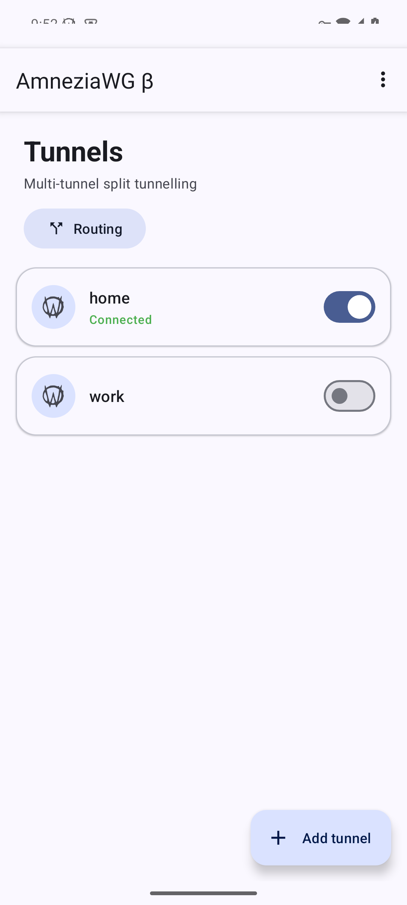
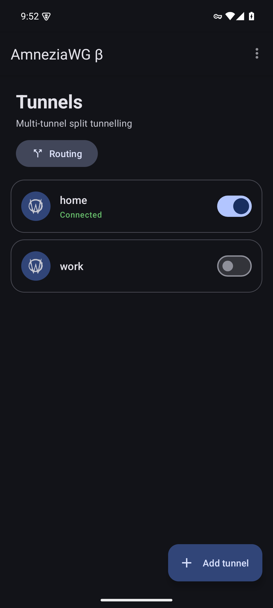
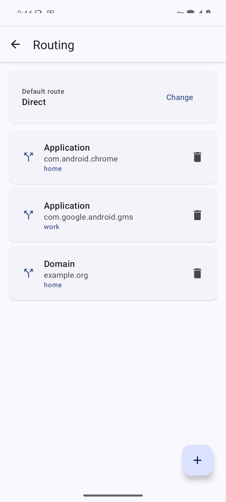
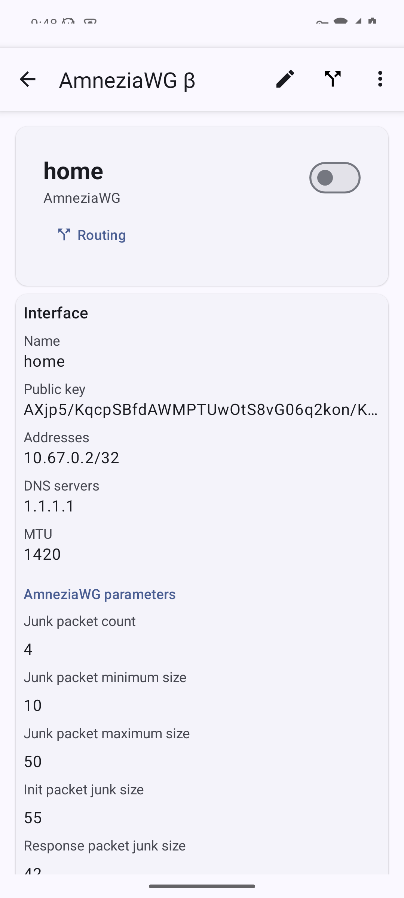
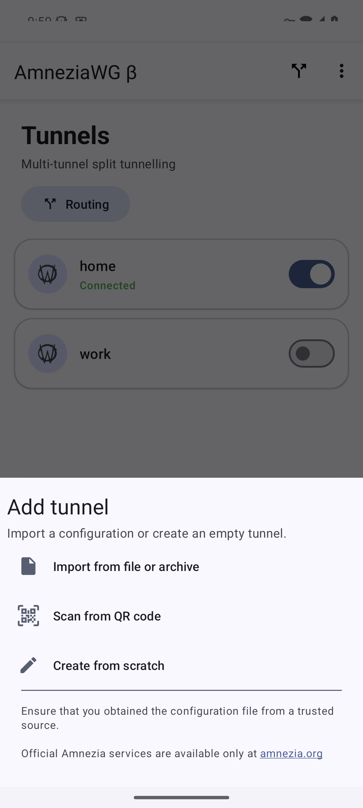

# AmneziaWG Fork — multi-tunnel split tunnelling

Android GUI for [AmneziaWG](https://amnezia.org/learn-more/31_amneziawg) with a
[sing-box-lx](https://github.com/Leadaxe/sing-box-lx) routing core.

## What is different from upstream

- **Several tunnels can be active at the same time.** One Android `VpnService` hosts one TUN and
  any number of AmneziaWG/WireGuard endpoints.
- **Routing rules** send an application, a domain or an IP/CIDR through a chosen tunnel, directly
  or to a block action.
- Existing per-app `IncludedApplications` / `ExcludedApplications` from a `.conf` are converted
  into routing rules automatically.
- AmneziaWG **1.x, 2.0 and 3.x** parameters (`Jc/Jmin/Jmax`, `S1–S4`, `H1–H4`, `I1–I5`, header
  protection, padding) are passed to the engine as-is.
- The UI keeps the existing XML/Material 3 screens and adds a **Routing** screen; the tunnel
  list, detail hero, add-tunnel sheet and dark/light themes were redesigned.
- Minimum Android version: **10 (API 29)**.

## Screenshots

| Main (light) | Main (dark) | Routing |
|---|---|---|
|  |  |  |

| Tunnel detail | Add tunnel |
|---|---|
|  |  |

## Building

```bash
git clone --recurse-submodules https://github.com/Skeltx/AmneziaWG-Fork
cd AmneziaWG-Fork
./scripts/fetch-libbox.sh
./gradlew assembleDebug
```

The `libbox.aar` is pinned to `1.14.4-lx.37` and is intentionally not committed (about 120 MB).
`scripts/fetch-libbox.ps1` is available for Windows.

## Status

The routing core and the new Routing screen were tested on an Android 15 emulator:

- two AmneziaWG endpoints start at the same time;
- `com.android.chrome` is routed through one tunnel and `com.google.android.gms` through another;
- a domain rule (`example.org`) is matched after TLS/HTTP sniffing;
- the service stops cleanly and removes the VPN interface.

A live tunnel handshake was not tested in this repository because no test server credentials are
stored here. Use a real AmneziaWG server for end-to-end verification.

## Licences

The combined fork is distributed under **GPL-3.0** because it embeds sing-box-lx. The original
AmneziaWG Android sources remain available under **Apache-2.0**; see
[`LICENSE-APACHE-2.0`](LICENSE-APACHE-2.0). See [`NOTICE`](NOTICE) for third-party components.
